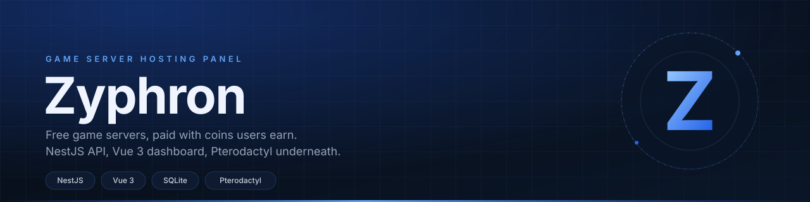

<p align="center">
  
</p>

# Zyphron Free Dashboard

[](LICENSE)
[](#requirements)
[](#stack)

Self-hosted client area for a free game server host. Players collect coins from daily
logins, AFK time and the store, then spend them on servers that get created on your
Pterodactyl panel. Admins handle users, coin balances, plans, tickets and the panel
connection from one dashboard.

This is the whole thing: API, database and frontend. No external account service, no
paid plan, no telemetry.

## what you get

- **Accounts** with JWT login, email verification, 2FA and password reset over SMTP.
- **Coins** earned per day, per AFK session and through the coin shop, spent on plans.
- **Servers** created, renewed and deleted through the Pterodactyl application API.
- **Admin panel** for users, roles, services, plans, coins, vouchers, tickets,
  email templates and panel settings.
- **API keys** with Pterodactyl-style permission sets, so other sites can talk to it.
- **Backup and migration scripts** in `scripts/` for moving the whole install to a
  new VPS.

## stack

| layer | what |
|---|---|
| api | NestJS 11, TypeORM, JWT, passport |
| db | SQLite through `better-sqlite3` (MySQL if you set `DB_TYPE=mysql`) |
| ui | Vue 3, Pinia, vue-router, Tailwind 4, Vite |
| mail | nodemailer, SMTP settings stored in the database and editable from admin |
| panel | Pterodactyl application API |
| process | pm2, config in `ecosystem.config.js` |

## requirements

- Node.js 20 or newer
- a Pterodactyl panel with an application API key (client API keys are not enough)
- SMTP credentials if you want verification and reset mails to actually leave the box

## quick start

```bash
git clone https://github.com/SirYadav1/zyphron-free-dash.git
cd zyphron-free-dash
npm install
cp .env.example .env
```

Fill at least these in `.env`:

```
JWT_SECRET=<32+ random chars>
PORT=3000
NODE_ENV=development
DB_TYPE=sqlite
DB_DATABASE=zyphron.db
ADMIN_KEY=<random setup key>
FRONTEND_URL=http://localhost:5173
```

Start both halves with one command:

```bash
npm run dev          # api on :3000, vite on :5173
```

Or run them separately with `npm run dev:backend` and `npm run dev:frontend`.

### first admin

The setup endpoint works once, with the `ADMIN_KEY` from `.env`:

```bash
curl -X POST http://localhost:3000/api/auth/setup-admin \
  -H 'Content-Type: application/json' \
  -d '{"setupKey":"<ADMIN_KEY>","username":"admin","email":"you@example.com","password":"Passw0rd1"}'
```

SQLite does not verify the address for you, so flip the flag before the first login:

```bash
sqlite3 zyphron.db "update users set email_verified=1 where email='you@example.com';"
```

Then log in, open the admin panel and paste your panel URL and API key under settings.

## configuration

Everything lives in `.env`. The admin panel can override SMTP and panel settings at
runtime, they are stored in the database and encrypted.

| variable | purpose |
|---|---|
| `JWT_SECRET` | signs access tokens, changing it logs everyone out |
| `JWT_EXPIRES_IN` | token lifetime, `7d` by default |
| `PORT` | api port, `3000` by default |
| `DB_TYPE` / `DB_DATABASE` | `sqlite` and a file path, or `mysql` and a database name |
| `PTERODACTYL_PANEL_URL` | panel base URL, trailing slash matters |
| `PTERODACTYL_API_KEY` | application key, starts with `ptla_` |
| `MAIL_HOST` / `MAIL_PORT` / `MAIL_USER` / `MAIL_PASS` | SMTP account |
| `MAIL_FROM` | sender address on outgoing mail |
| `DISCORD_CLIENT_ID` / `DISCORD_CLIENT_SECRET` | Discord OAuth login, optional |
| `DISCORD_CALLBACK_URL` | must match the redirect URL in the Discord app |
| `DISCORD_BOT_TOKEN` / `DISCORD_GUILD_ID` | optional, used by the Discord module |
| `ADMIN_KEY` | one-time key for `POST /api/auth/setup-admin` |
| `FRONTEND_URL` | CORS origin and link base for emails |

## production

```bash
npm run build        # client/dist and dist/
NODE_ENV=production node dist/src/main.js
```

With `NODE_ENV=production` TypeORM stops syncing the schema and the backend serves
`client/dist` itself. Put nginx in front for TLS, upload limits and the security
headers, then keep the process alive with:

```bash
pm2 start ecosystem.config.js
```

Moving to another box:

```bash
bash scripts/backup.sh          # tar of db, .env, source, nginx conf, client build
bash scripts/deploy-to-vps.sh   # fresh server
bash scripts/migrate.sh         # restore the tar on the new server
```

## layout

```
src/                nest modules, one folder per domain
  auth/             login, jwt, 2fa, password reset, admin setup
  pterodactyl/      panel api client
  servers/          create, renew, suspend, delete
  admin/            admin endpoints and settings
  common/           guards, decorators, encryption util, filters
client/             vue app (views/, components/, stores/, i18n/)
scripts/            backup, deploy and migrate shell scripts
docs/security/      one file per day of the sprint plus the release closeout
assets/             banner used by this readme
```

## docs

- [`docs/security/`](docs/security/) - findings, fixes and what is still open.
  Start with [`FINAL.md`](docs/security/FINAL.md) if you only read one file.
- [`docs/PTERODACTYL-API.md`](docs/PTERODACTYL-API.md) - the panel endpoints this
  app calls.

## known gaps

- no automated tests and no CI. Every check in the security notes was run by hand.
- Pterodactyl features need a real panel. Without one the server pages load but do
  nothing useful.
- mail needs working SMTP, otherwise verification and reset mails are dropped.
- rate limits are in-process, so they reset on restart and do not cover a second
  worker.
- the nginx site config is not in this repo yet (see ZY-06 in the closeout).

## license

[PolyForm Noncommercial 1.0.0](LICENSE). You can read the code, run it, change it and
self-host it for personal or other noncommercial use. You cannot sell it, bundle it
into a paid product or run it as a paid service. Keep the copyright notice and the
`Required Notice:` line in place.
